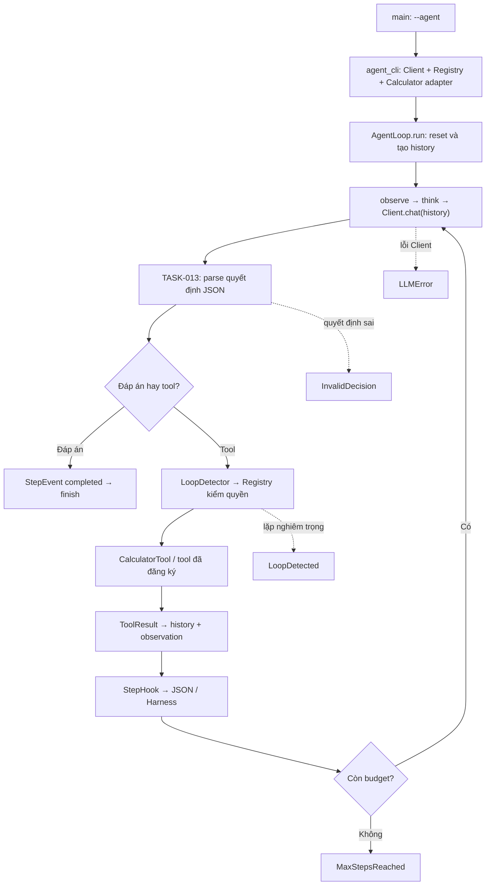
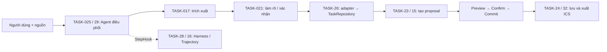

# TASK-025 — AgentLoop: ReAct, history và giới hạn max_steps

Cập nhật: **05/11/2026**. Source nền trước thay đổi: `8d8a7a0`.

**Đã triển khai và kiểm thử TASK-025 theo phạm vi bảng phân công:** hiện thực
`AgentLoop::run()` theo Template Method, quản lý history và dừng ở `max_steps`.
Build local thành công; root CTest **10/10 PASS**, trong đó bộ TASK-025 có
**26 ca unit/mock PASS** và **7 nhóm HTTP/CLI PASS**. Các test dùng AgentLoop,
parser và Registry thật, với LLM hoặc server HTTP giả. Kết quả này kiểm chứng
vòng Agent, không phải phép đo độ chính xác của model.

## 1. Giải thích kết quả đầu ra của task

### 1.1. Phạm vi đã đối chiếu

Theo [bảng phân công, tab Deadline TASK-13–64](https://docs.google.com/spreadsheets/d/1wr1-VLsDf7ww94ATbir1B8VA1_vkPdqlL3m5Hn_nuPs/edit?gid=95448762),
TASK-25 phụ trách vòng chạy Agent, history và giới hạn bước; cho phép dùng
MockLLMClient cùng DummyTool để kiểm chứng. Dependency chính là AgentLoop header
của TASK-05, Client/parser của TASK-013 và Registry của TASK-10.

Luồng nhập đề cương/ảnh → gọi công cụ lập lịch → giải thích thuộc **TASK-29**.
Đóng gói ScheduleSolverTool thuộc TASK-23; nối kết quả tool vào repository thuộc
TASK-26; hook phía Harness được tiếp tục phát triển ở TASK-28; lưu/xuất toàn bộ
MVP thuộc TASK-32. Các phần đó không phải điều kiện để kết luận vòng Agent
TASK-025 đã được triển khai.

Tài liệu trước khi đối chiếu bảng phân công đã gộp các phần tích hợp MVP vào
TASK-025. Bản này sửa lại phạm vi theo yêu cầu thực tế và code đã hoàn thiện.

### 1.2. Sau thay đổi, Agent thực hiện được gì?

Agent nhận mục tiêu qua `run(user_goal)` và thực hiện:

1. Reset trạng thái lượt trước, tạo system message và lưu mục tiêu.
2. Chuẩn bị observation rồi gọi LLM với lịch sử hiện tại.
3. Phân tích phản hồi bằng parser JSON TASK-013.
4. Nếu có đáp án thì kết thúc; nếu có tool call thì kiểm lặp và gọi Registry.
5. Lưu kết quả tool vào history, phát sự kiện và dùng observation cho bước sau.
6. Dừng khi hoàn thành, hết budget, lỗi LLM/parser hoặc lặp nghiêm trọng.

Một bước được tính là một lượt quyết định của Agent. Mỗi bước mặc định chỉ
nhận một tool call hoặc một đáp án; nhiều tool calls trong cùng phản hồi bị
từ chối trước khi chạy bất kỳ tool nào.

| Đầu ra | Công dụng |
|---|---|
| Chuỗi do `run()` trả về | Giữ tương thích với code gọi Agent trước đây. |
| `AgentRunResult` qua `lastResult()` | Cho biết trạng thái, đáp án, số bước và số lần gọi `act()`. |
| `history()` | Truy cập read-only lịch sử của lượt vừa chạy để kiểm tra và trình bày. |
| `StepEvent` qua `StepHook` | Quan sát từng bước, kết quả tool, thời gian, lỗi, trạng thái cuối và phản hồi model. |
| JSON của CLI `--agent` | Lưu result, events, history và metadata model để đối chiếu. |

`tool_calls` đếm số lần Agent gọi `act()`, kể cả khi Registry từ chối. Muốn biết
tool thực sự thành công phải kiểm tra `event.tool_result.success`.

### 1.3. Những điểm được hoàn thiện từ code nền

| Code nền | Kết quả sau TASK-025 |
|---|---|
| Parser tìm `Action:` và truyền `"{}"` | Tái sử dụng parser TASK-013, giữ arguments JSON thật, kiểm lỗi và tên tool. |
| Chỉ trả chuỗi cho các kiểu kết thúc | Có `AgentStatus`; Harness không còn đoán thành công từ tiền tố đáp án. |
| Kết quả tool chỉ vào lịch sử khi còn lượt LLM tiếp | Lưu ngay sau `act()`, gồm kết quả ở bước cuối. |
| Chưa có demo Agent thật từ CLI | Thêm `ai_agent --agent`, nối OllamaClient, Registry và CalculatorTool. |
| Test cũ ghi đè parser bằng dữ liệu giả | Test mới dùng AgentLoop/parser thật, chỉ giả LLM hoặc server HTTP. |
| Hook Harness giữ reference cục bộ sau `runTask()` | Có guard gỡ hook khi thoát, kể cả khi có exception. |

### 1.4. Trạng thái kết thúc

| `AgentStatus` | Ý nghĩa | `success()` |
|---|---|---|
| `NotStarted` | Chưa chạy | false |
| `Running` | Đang chạy | false |
| `Completed` | Model đưa ra quyết định trả lời cuối cùng | true |
| `MaxStepsReached` | Đã dùng hết số bước, chưa có đáp án cuối | false |
| `LoopDetected` | Detector yêu cầu dừng vì lặp nghiêm trọng | false |
| `LLMError` | Thiếu Client hoặc Client trả lỗi | false |
| `InvalidDecision` | JSON/quyết định sai, đáp án rỗng, phản hồi bị cắt hoặc nhiều calls | false |

`Completed` là hoàn thành giao thức vòng chạy, không tự chứng minh câu trả lời
đúng nghiệp vụ. Evaluator hoặc tiêu chí kiểm thử độc lập vẫn cần chấm kết quả.
`thought` trong sự kiện là nhãn hành động, không phải suy luận nội bộ của model.

### 1.5. Cách chạy và minh chứng

Chế độ Agent:

```text
ai_agent --agent --model TEN_MODEL --url http://127.0.0.1:11434 --goal "Use calculator to compute 15 + 17" --max-steps 6 --output output/agent_result.json
```

CLI cấp quyền cho adapter `calculator`; adapter gọi lại CalculatorTool TASK-11.
Các tùy chọn thêm: `--temperature`, `--max-tokens`, `--timeout-ms`,
`--connect-timeout-ms`. Exit code: **0** khi Completed, **2** khi Agent dừng
không thành công, **1** khi lỗi cấu hình/CLI/ghi file. Chế độ thử API TASK-09
với `--text` hoặc `--image` vẫn được giữ nguyên.

Kiểm chứng đã thực hiện trên Windows, GCC 16.1.0, CMake, libcurl và SQLite:

```text
cmake -S . -B build/task025-mingw -G "MinGW Makefiles" -DCMAKE_MAKE_PROGRAM=C:/msys64/ucrt64/bin/mingw32-make.exe -DCMAKE_CXX_COMPILER=C:/msys64/ucrt64/bin/g++.exe -DBUILD_TESTING=ON -DCMAKE_BUILD_TYPE=Release
cmake --build build/task025-mingw --parallel 2
ctest --test-dir build/task025-mingw --output-on-failure
```

Kết quả: root **10/10 PASS**; `task025_unit_results.json` báo **26/26**;
`task025_http_results.json` báo **7/7**. Các nhóm regression được chạy gồm
agent_contract, scheduler, trajectory_ics, memory_tool, ollama_client,
ollama_http, task13_parser và task13_client_transport.

Các báo cáo local nằm trong `build/task025-mingw/`, là output build không theo
dõi trong Git. Bộ TASK-017/021 có build riêng; kết quả của chúng không được
ngầm tính vào 10 nhóm root CTest.

Đoạn giới thiệu khi báo cáo:

> TASK-025 hiện thực vòng điều phối ReAct của Agent. Agent nhận mục tiêu, gọi
> model để chọn một hành động, thực thi công cụ qua Registry rồi đưa kết quả
> vào lịch sử cho bước tiếp theo. Vòng chạy có giới hạn số bước, kiểm tra lặp
> và trạng thái kết thúc rõ ràng. Phần triển khai dùng lại parser TASK-013 và
> giữ hook để Harness theo dõi. Em đã kiểm chứng bằng mock và HTTP integration.

## 2. Vai trò của file và các hàm liên quan

Số dòng ở bảng hàm đối chiếu theo source khi viết tài liệu; có thể thay đổi
sau các lần chỉnh sửa. Phần code nền TASK-05/09 được tái sử dụng, không tính
toàn bộ file là code mới của TASK-025.

### 2.1. Header Agent và implementation

File [include/agent/agent_loop.h](../include/agent/agent_loop.h) định nghĩa
`ToolCallAction`, `FinalAnswerAction`, `AgentDecision`, `StepEvent`, `StepHook`
và lớp AgentLoop. TASK-025 thêm `AgentStatus`, `AgentRunResult`,
`StepEvent.terminal_status`, `StepEvent.model_response`, `lastResult()` và
`history()`, cùng trạng thái nội bộ phục vụ kết thúc và báo lỗi.

`decision` optional rỗng nếu không có quyết định hợp lệ; `tool_result` optional
rỗng khi chưa gọi `act()`. Không nhầm “không gọi tool” với “tool đã trả lỗi”.

File [src/agent/agent_loop.cpp](../src/agent/agent_loop.cpp) thực hiện vòng chạy:

| Dòng bắt đầu | Hàm | Công dụng |
|---|---|---|
| 11 | `to_string(AgentStatus)` | Ánh xạ trạng thái thành tên ổn định cho JSON. |
| 24 | `AgentLoop(...)` | Lưu Client, detector và budget; từ chối `max_steps < 1`. |
| 31 | `setStepHook()` | Đăng ký hoặc xóa callback quan sát bước. |
| 32 | `setToolRegistry()` | Mượn Registry để chạy tool; không nhận quyền sở hữu. |
| 34 | `finish()` | Cập nhật trạng thái/đáp án cuối, gọi `onFinished()` rồi trả chuỗi. |
| 42 | `run()` | Template Method giữ thứ tự Observe → Think → kiểm lặp → Act/Final → báo sự kiện. |
| 110 | `reportStep()` | Tính thời gian cả bước trước callback và phát StepEvent. |
| 117 | `onStart()` | Reset history/detector; tạo system prompt với giao thức JSON và các tool được phép; lưu mục tiêu. |
| 140 | `observe()` | Mặc định trả nguyên input; lớp con có thể thay đổi cách chuẩn bị observation. |
| 142 | `think()` | Thêm observation nếu chưa có, gọi Client, giữ raw content/metadata, chặn truncated response và parse quyết định. |
| 172 | `act()` | Gọi Registry bằng tên/tham số; thiếu Registry hoặc exception chuẩn được đổi thành ToolResult lỗi. |
| 183 | `isTerminal()` | Mặc định kết thúc khi có FinalAnswerAction. Budget được giữ riêng trong run. |
| 188 | `onFinished()` | Điểm tùy biến cuối lượt; mặc định không làm gì để tránh thêm đáp án hai lần vào history. |
| 190 | `parseDecision()` | Dùng parser TASK-013; kiểm một call mỗi bước, JSON arguments, final_answer và định dạng lỗi. |

`run()` không virtual; các bước protected là virtual. Ví dụ lớp con có thể
đổi `observe()` hoặc `parseDecision()` mà vẫn dùng thứ tự chung. `lastResult()`
và `history()` trả tham chiếu const, dùng sau `run()` và trước lượt kế tiếp.

### 2.2. CLI, Calculator và JSON trace

File [src/agent/agent_cli.cpp](../src/agent/agent_cli.cpp) được thêm cho demo:

| Thành phần | Công dụng |
|---|---|
| `JsonCalculator::name()/description()` | Công bố tên tool và cấu trúc arguments có trường expression. |
| `JsonCalculator::execute()` | Kiểm arguments JSON rồi chuyển expression sang CalculatorTool TASK-11. |
| `positive()` | Đọc số nguyên dương, từ chối số lẻ, ký tự thừa hoặc giá trị ngoài miền int. |
| `event_json()` | Chuyển StepEvent thành JSON, giữ observation, quyết định, lỗi, tool result và raw model content. |
| `run_agent_application()` | Đọc cấu hình, tạo Client/Registry/Agent, gắn hook, chạy và lưu báo cáo. |

[include/agent/agent_cli.h](../include/agent/agent_cli.h) khai báo entry point.
[src/main.cpp](../src/main.cpp) chuyển sang entry point này khi tham số đầu
tiên là `--agent`. Luồng cũ vẫn chạy theo cách trước đây; đoạn demo khung cũ
không được dùng làm minh chứng cho chế độ Agent mới.

JSON CLI có `status`, `success`, `answer`, `steps`, `tool_calls`, `events`,
`history`, `model_requested` và nguồn `ollama`. Khi chạy HTTP mock, server/model
là giả dù CLI vẫn dùng cùng HTTP Client; báo cáo test ngoài ghi rõ `http_mock`.

### 2.3. File build và phần kết nối Harness

| File | Thay đổi/vai trò |
|---|---|
| [CMakeLists.txt](../CMakeLists.txt) | Thêm parser TASK-013 vào agent_core; thêm CLI/Calculator vào executable; đăng ký task025_unit và task025_http. |
| [src/harness/harness_runner.h](../src/harness/harness_runner.h) | Dùng lastResult().success() và guard gỡ callback giữ reference tới trajectory cục bộ. |
| [include/agent/loop_detector.h](../include/agent/loop_detector.h) | Tái sử dụng recordAndCheck/reset; không thay thuật toán TASK-33. |
| [src/agent/agent_loop.h](../src/agent/agent_loop.h) | Header chuyển tiếp tới định nghĩa chính trong include; không tạo lớp thứ hai. |
| [src/client/llm_client.h](../src/client/llm_client.h) | Header chuyển tiếp tới giao diện Client chính. |

`agent_core` dùng parser độc lập, không buộc mock test phải gọi HTTP.
`task13_parser` vẫn là target riêng phục vụ các kiểm thử độc lập TASK-013.
Không sửa implementation của Registry, CalculatorTool hoặc Client dùng chung.

### 2.4. Các file kiểm thử

| File | Vai trò và hàm chính |
|---|---|
| [tests/task025/agent_loop_test.cpp](../tests/task025/agent_loop_test.cpp) | ScriptedClient giả phản hồi; DummyTool giả thành công/lỗi; Fixture thiết lập dependency; main chạy 26 ca và xuất JSON. Dùng parser thật, không ghi đè parser. |
| [tests/task025/agent_http_test.py](../tests/task025/agent_http_test.py) | Handler giả endpoint Ollama; main gọi executable thật để kiểm history HTTP, Calculator, budget, loop, JSON lỗi, HTTP lỗi, phục hồi và CLI validation. |
| [tests/agent_contract_test.cpp](../tests/agent_contract_test.cpp) | Giữ test giao diện cũ để kiểm tương thích lớp con và hook. |

## 3. Nguyên lý hoạt động và mối liên hệ giữa các file, các task

### 3.1. Luồng runtime hiện đã nối



Ví dụ HTTP integration: model giả gửi lệnh calculator với expression `15 + 17`;
CalculatorTool thật trả `32`; request LLM kế tiếp có `Observation: 32` và giữ
nguyên phản hồi assistant trước đó; model trả final_answer; Agent kết thúc ở
bước 2. Hook của bước gọi tool chạy sau tool, nên đã có kết quả và thời gian.

Giao thức đang dùng là **JSON trong content qua `LLMClient::chat()`**:

```json
{"tool_name":"calculator","arguments":{"expression":"15 + 17"}}
```

```json
{"final_answer":"Kết quả là 32."}
```

Phản hồi văn bản thường vẫn được chấp nhận là đáp án để tương thích Client cũ.
JSON hỏng, khóa trùng, tool không có trong danh sách đã đăng ký, arguments sai,
đáp án rỗng, nội dung bị cắt và nhiều calls bị chặn. Không quay lại parser
`Action:` cũ để đoán tham số. Native `chat_with_tools()` của TASK-013 vẫn là
API riêng; bản này không tuyên bố đã quản lý native tool-call history.

### 3.2. History, budget, quyền thực thi và lỗi

History chỉ sống trong một lượt chạy: system → mục tiêu → observation đầu →
assistant call → observation kết quả → assistant đáp án. Kết quả tool được
lưu ngay; `think()` không thêm lại observation giống hệt. Lượt mới reset history,
detector và result; không biến history thành bộ nhớ dài hạn.

Ở bước cuối, nếu model gọi tool thì tool vẫn chạy và kết quả vẫn được lưu;
sau đó Agent trả MaxStepsReached, không gọi thêm LLM. Nếu model trả đáp án ngay
ở bước cuối thì kết quả là Completed.

Parser chỉ kiểm cấu trúc và tên. Registry kiểm tool tồn tại, có trong allowlist
và không bị deny trước khi gọi execute. Tool thất bại trở thành observation để
model có thể phục hồi. Lỗi LLM/parser và lặp nghiêm trọng làm dừng lượt chạy.

Client được giữ bằng shared_ptr; Registry là con trỏ mượn và phải sống hết run.
Hook chạy đồng bộ, không nên ném exception. Muốn lưu sự kiện thì copy dữ liệu.
Trong callback, đọc trạng thái cuối qua event.terminal_status; lastResult được
chốt sau callback khi finish chạy. Đây chưa phải lớp an toàn để chạy cùng một
AgentLoop đồng thời từ nhiều thread.

### 3.3. Quan hệ và trách nhiệm giữa các task

| Task | Đóng góp | Quan hệ với TASK-025 |
|---|---|---|
| TASK-05 | Header Agent/LoopDetector và khung Template Method | Nền được kế thừa; TASK-025 hoàn thiện runtime và trạng thái. |
| TASK-09 | OllamaClient và LLMResult dùng expected | think gọi qua interface; Client lo HTTP/cấu hình/lỗi mạng. |
| TASK-013 | Parser JSON, multimodal và API tool chat | Parser đã nối trong Agent; native tool chat và ảnh có thể tiếp tục tích hợp ở MVP. |
| TASK-06/10 | ITool, ToolResult, Registry và domain | act gọi Registry; quyền không do model/parser cấp. |
| TASK-11 | CalculatorTool | Demo CLI dùng tool thật qua adapter JSON. |
| TASK-08/16 | Harness, Trajectory, xuất lịch | Hook dùng để quan sát; Harness đã đọc trạng thái kết thúc mới. Xuất lịch không thuộc vòng Agent cơ bản. |
| TASK-28 | Hoàn thiện observer phía Harness | Tiếp nhận StepEvent của TASK-025; có thể bổ sung các field chưa ánh xạ sang Step. |
| TASK-33 | Hoàn thiện Generic Repeat/Ping-Pong | TASK-025 dùng detector hiện có; không nhận thay phạm vi hoàn thiện thuật toán. |
| TASK-017/021 | Trích xuất và xác nhận deadline | Module nghiệp vụ cho MVP; không tự được gọi chỉ vì AgentLoop tồn tại. |
| TASK-14/20/26 | FileTool, repository, lưu bền và nối dữ liệu | Cung cấp dữ liệu/ghi kho cho tầng tích hợp; không đồng nhất history với DB. |
| TASK-15/23/27 | Scheduler, tool lập lịch và strategy | Cung cấp proposal sau khi dữ liệu hợp lệ; không tự được cấp quyền hoặc commit lịch bởi parser. |
| TASK-29/32 | Ghép MVP và luồng lưu/xuất tổng thể | Dùng vòng Agent TASK-025 làm tầng điều phối chung. |

### 3.4. Hình thành hệ thống chung ở các bước tích hợp kế tiếp

Sơ đồ dưới là quan hệ cần nối cho MVP, không phải toàn bộ luồng đã thực hiện
trong TASK-025:



Các ranh giới phải giữ khi ghép:

- TASK-017 trả ExtractedWorkItem và evidence; adapter mới chuyển thành Task hợp
  lệ, cấp ID và liên kết môn. Không coi dữ liệu trích xuất là Task đã lưu.
- TASK-021 chỉ cấp deadline khi đủ điều kiện. Xác nhận phải từ thao tác thật của
  người dùng, gắn đúng source/item/revision; model không tự đặt cờ xác nhận.
- Xác nhận thời điểm deadline và xác nhận áp dụng lịch nháp là hai thao tác
  khác nhau. Scheduler tạo proposal, không tự commit hoặc ghi DB.
- Các task dùng chung Task, TimePoint, Schedule và TimeSlot; tránh tạo kiểu dữ
  liệu tương tự nhưng lệch ý nghĩa. Các khoảng thời gian theo quy ước [start, end).
- History là hội thoại trong lượt, MemoryTool lưu ghi chú, TaskRepository quản
  lý Task, Trajectory lưu hành trình. Chúng có vòng đời và mục đích riêng.
- JSON CLI giữ đầy đủ StepEvent để đối chiếu. Harness hiện ánh xạ một phần field
  sang Step; TASK-28 có thể bổ sung observation, lỗi và thông báo lặp theo schema chung.

Tài liệu nền: [Agent contract TASK-05](agent_contract.md),
[TASK-013](TASK013_IMPLEMENTATION.md), [TASK-017](TASK-017.md),
[TASK-021](TASK-021.md), [kiến trúc header](HEADER_ARCHITECTURE.md).
